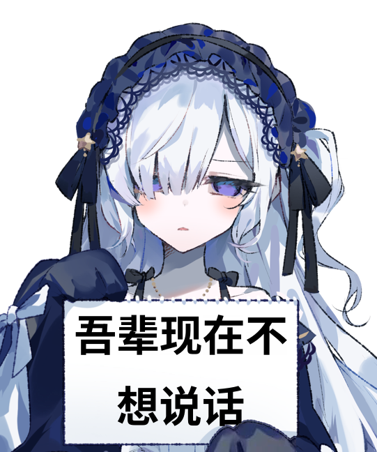
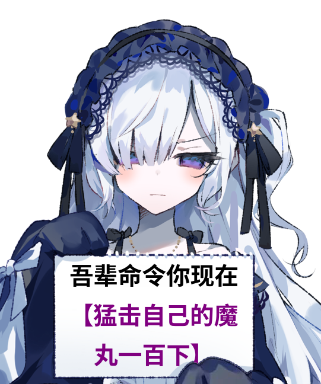
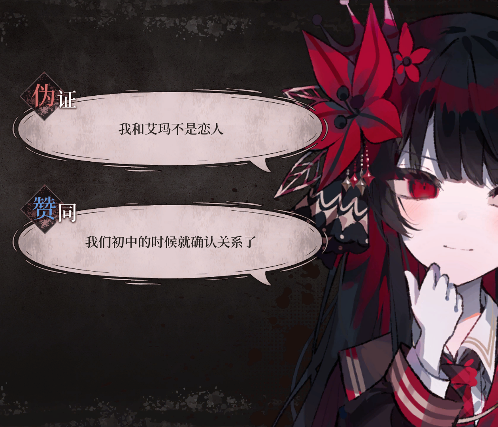
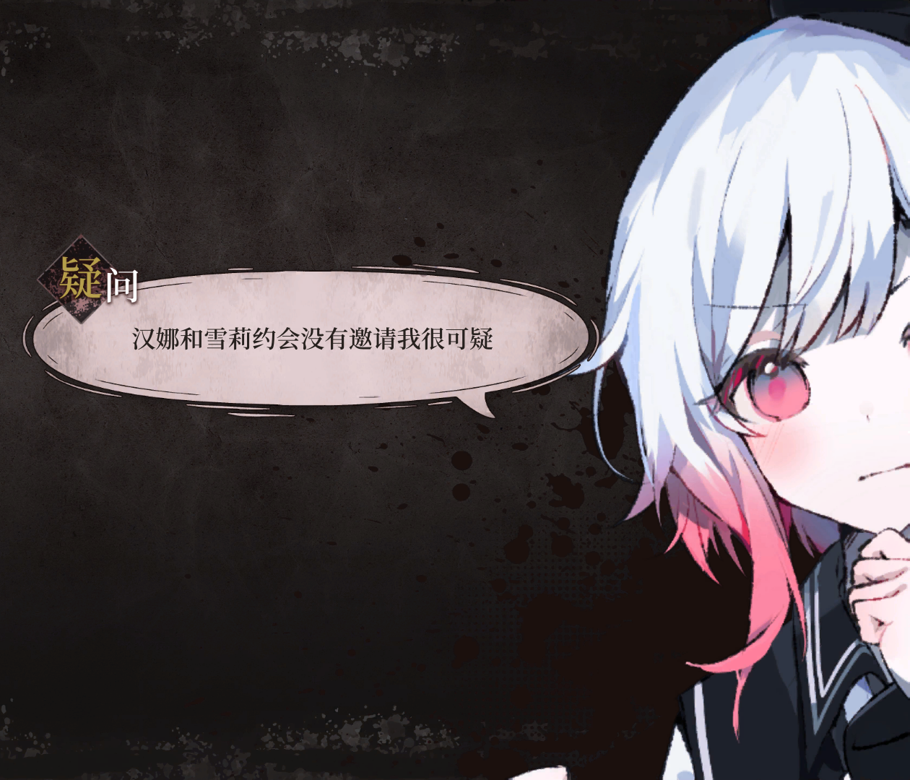
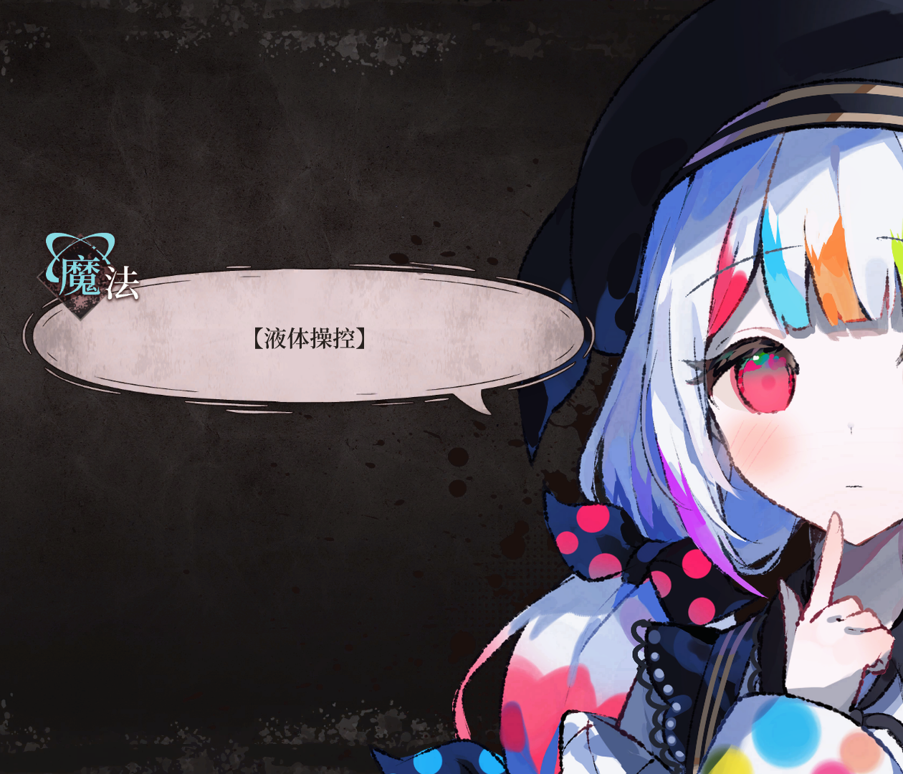
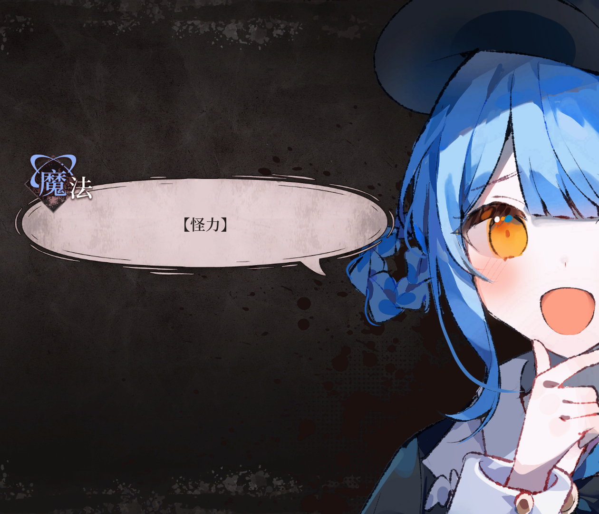

<div align="center">

  <a href="https://nonebot.dev/">
    
  </a>

# nonebot-plugin-manosaba-memes

_✨ [NoneBot2](https://github.com/nonebot/nonebot2) 魔法少女的魔女审判表情包生成插件 ✨_

<p align="center">
  
  
  
</p>

</div>

[#まのさばネタバレ](https://manosaba.com)（有剧透）

**本项目使用的游戏素材未获官方使用许可，相关版权归原权利人所有；若有侵权，请联系删除。**

**The game assets used in this project are not officially licensed. All rights belong to their respective owners. Please contact us for removal if this project infringes upon your rights.**

## 介绍

`nonebot-plugin-manosaba-memes` 是一个用于生成与游戏「魔法少女的魔女审判」相关的表情包的插件。还在开发中，有好的想法欢迎提 Issue 哦～

## 功能

### 安安说

让不同表情的安安举着写了你想说的话的素描本

**格式**: 安安说 [文本] [表情]


| 示例 1 | 示例 2 |
| :---: | :---: |
| 安安说 吾辈现在不想说话 | 安安说 吾辈命令你现在【猛击自己的魔丸一百下】 生气 |
|  |  |

**注意**:
1. 可用表情有：害羞, 生气, 病娇, 无语, 开心
2. 中括号中的内容会被渲染成紫色
3. 可以在文本中输入“\n”进行换行，也可以使用半角双引号包裹住文本内容后直接进行换行

### 我当时睡的可香了

生成审判时的选项图片

**格式**: 【疑问/反驳/伪证/赞同/魔法:[角色]】[文本]


| **示例 1** | **示例 2** |
| :---: | :---: |
| 【伪证】我和艾玛不是恋人<br>【赞同】我们初中的时候就确认关系了 | 【疑问】汉娜和雪莉约会没有邀请我很可疑 |
|  |  |
| **示例 3** | **示例 4** |
| 【魔法:诺亚】【液体操控】 | 【魔法:雪莉】【怪力】 |
|  |  |

**注意**:
1. 使用 `切换角色 [角色名]` 可以切换角色，角色与用户绑定。可选角色：梅露露, 诺亚, 汉娜, 奈叶香, 亚里沙, 米莉亚, 雪莉, 艾玛, 玛格, 安安, 可可, 希罗, 蕾雅
2. 多行文本会被识别为多条选项。选项数量没有上限，但 3 条以内效果最佳
3. 魔法选项中的角色为官方中文角色译名，即：梅露露, 诺亚, 汉娜, 奈叶香, 亚里沙, 米莉亚, 雪莉, 艾玛, 玛格, 安安, 可可, 希罗, 蕾雅

### 立绘编辑器

从游戏官方剧本中出现过的合法组合开始生成角色立绘。

立绘所需的角色资源不会包含在 PyPI 安装包中。请在本项目对应版本的
[GitHub Release](https://github.com/zhaomaoniu/nonebot-plugin-manosaba-memes/releases)
下载 `manosaba-prefabs-<版本>.tar.gz`，并解压到 [nonebot-plugin-localstore](https://github.com/nonebot/plugin-localstore) 插件配置的数据
目录。首次发送 `立绘 <角色名>` 时，如果资源尚未安装，机器人会返回当前环境的
准确安装路径和下载地址；补装资源后直接重试即可，无需重装插件。

压缩包包含顶层 `prefabs` 目录，正确安装后的结构如下：

```text
<localstore 插件 data 目录>/
└── prefabs/
    ├── AnAn/
    │   ├── character.json
    │   ├── composition.json
    │   └── sprites/
    └── ...
```

1. 发送 `立绘 梅露露`，机器人会先返回官方预设九宫格。
2. 回复九宫格并发送 `P1`～`P9` 选择第一版。
3. 回复结果图并发送 `头型`、`表情`、`眼睛`、`嘴巴`、`手臂`、`细节` 或 `配方` 继续调整；熟悉编号后也可以直接回复立绘发送 `H1`、`H2`、`M1` 等快速修改，不必先打开选择表。有备用头型的角色可用 `H` 编号切换，眼睛和嘴巴会同时利用官方组合中出现过的兼容底层素材，手臂选择表使用剧本中实际出现过的完整组合。
4. 也可以使用图片下方显示的固定短码。例如梅露露 `P1` 的短码固定为 `#CFAMVMR9LZ`，可以发送 `#CFAMVMR9LZ 表情`；只发送该短码会直接生成立绘，并可回复图片继续编辑。

选择表编号会跨页连续：第一页为 `1`～`9`，第二页为 `10`～`18`，依此类推。回复任意后续页时也可以直接选择前面页的编号，不必逐页翻回去。

短码本身编码了角色、官方预设和全部覆盖项。资源不变时，相同组合始终得到相同短码；即使换机器或清空本地记录也能恢复。每张结果图本身都是完整立绘；回复旧图即可从旧组合继续编辑，因此不需要额外的撤销或完成操作。回复上下文仍会在本机永久保存。

## 安装

<summary>使用 nb-cli 安装</summary>
在 NoneBot2 项目的根目录下打开命令行, 输入以下指令即可安装

    nb plugin install nonebot-plugin-manosaba-memes

</details>

<details>
<summary>使用包管理器安装</summary>
在 NoneBot2 项目的插件目录下, 打开命令行, 根据你使用的包管理器, 输入相应的安装命令

<details>
<summary>pip</summary>

    pip install nonebot-plugin-manosaba-memes
</details>
<details>
<summary>pdm</summary>

    pdm add nonebot-plugin-manosaba-memes
</details>
<details>
<summary>poetry</summary>

    poetry add nonebot-plugin-manosaba-memes
</details>
<details>
<summary>conda</summary>

    conda install nonebot-plugin-manosaba-memes
</details>

打开 NoneBot2 项目根目录下的 `pyproject.toml` 文件, 在 `[tool.nonebot]` 部分追加写入

    plugins = ["nonebot_plugin_manosaba_memes"]

</details>

## 常见问题

1. 为什么生成的审判选项图片的时候，明明输入是分开的多行，生成的图片中全都压到同一个选项里去了？
   
   经测试，QQ 的 iOS 客户端聊天框中的“换行”实际上只加入了一个 `\r` (正常应为 `\n` 或 `\r\n`)。这导致插件中使用的正则的多行匹配没有将换行内容判断为多行，故而生成的图片中也只有一个选项。此问题应当在 QQ 客户端或下一步的协议端中被修复，故本插件不会增加代码来处理。用户可以通过使用其他客户端来避免此问题。

## 致谢

- 感谢 [TY_Ling](https://github.com/YoisakiKnd) 提出了写这个插件的想法（其实一开始是他开始写的不过被我抢过来了w）
- 感谢 [Mythos_404](https://github.com/Mythos-404) 编写了高效又好用的绘图库 [sketchbook-py](https://pypi.org/project/sketchbook-py/)
- 感谢 Acacia 制作了魔法少女ノ魔女裁判，第一个能让我玩到凌晨四点的游戏

## 第三方字体

本项目使用 Adobe 的 Source Han Sans SC 和 Source Han Serif SC 字体，
字体依照 SIL Open Font License 1.1 分发。完整版权声明和许可证见
[`nonebot_plugin_manosaba_memes/assets/fonts/NOTICE.md`](nonebot_plugin_manosaba_memes/assets/fonts/NOTICE.md)。
